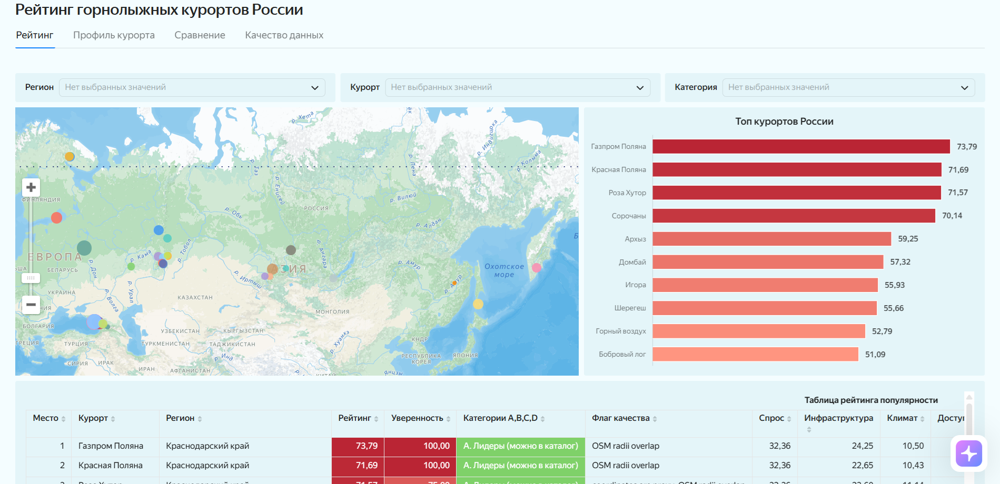
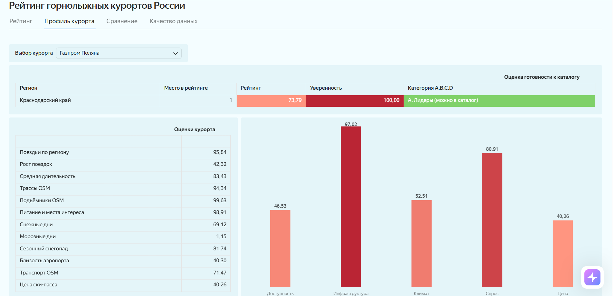
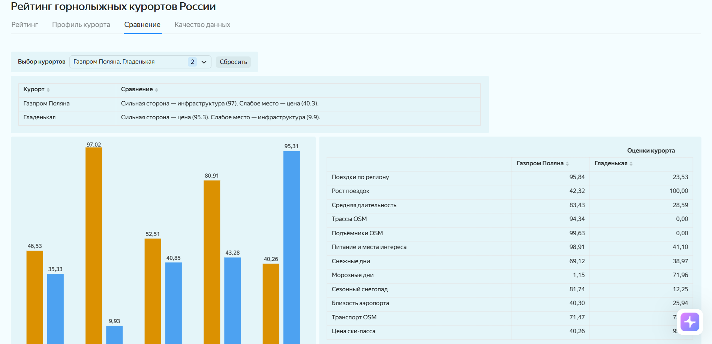
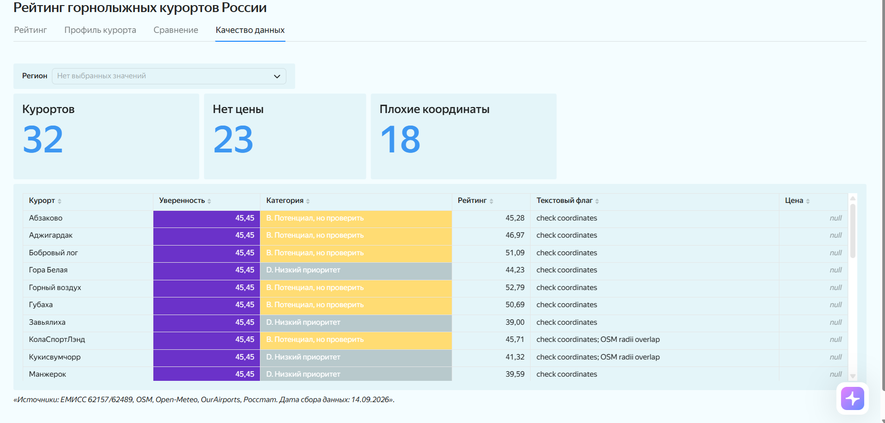

## Рейтинг горнолыжных курортов России (Travel Designer)

### О проекте
Разработка воспроизводимого составного рейтинга 32 горнолыжных курортов РФ для приоритизации добавления в каталог сервиса Travel Designer. 
Рейтинг оценивает потенциал курортов (0–100) на основе открытых данных, а не фактическую посещаемость.

**[Перейти на интерактивный дашборд (Yandex DataLens)](https://datalens.yandex/y6qu8oi4yepqh?_share_link=public)**





### Бизнес-задача
Прямой сопоставимой статистики посещаемости курортов нет. Требовалось собрать данные из нескольких источников (ЕМИСС, OSM, Open-Meteo, Росстат) и построить прозрачный рейтинг с оценкой уверенности в данных.

### Инструменты
* **Язык:** Python (Pandas, NumPy)
* **Визуализация в коде:** Matplotlib, Seaborn
* **BI-инструмент:** Yandex DataLens
* **Сбор данных:** REST API (Overpass, Open-Meteo, MediaWiki)
* **Тестирование:** Pytest

### Ключевые выводы 
1. **Топ-3 фактора:** На итоговый рейтинг сильнее всего влияют региональный турпоток (вклад 10.68 балла), количество трасс OSM (5.09) и рост турпотока (4.62).
2. **Лидеры:** Газпром Поляна, Красная Поляна и Роза Хутор. Они выигрывают за счет инфраструктуры (максимум объектов в OSM) и колоссального турпотока Краснодарского края.
3. **Зона риска:** Курорты с высоким потенциалом, но низкой уверенностью в данных (Игора, Горный воздух, Бобровый лог). Они требуют ручной проверки координат перед добавлением в каталог.
4. **Устойчивость:** При изменении весов (климат +20% или доступность +20%) Топ-5 остается стабильным, что говорит о надежности базовой модели.

### Структура проекта
* `01_data_analysis.ipynb` — исследовательский анализ, расчеты, сценарии весов и графики.   
* `ANALYSIS.md` — текстовый отчет с ответами на вопросы из ТЗ.   
* `data/raw/` — исходные данные (ЕМИСС, цены, климат, OSM).   
* `data/mart/` — финальная витрина `resort_scores.csv` для BI.   
* `src/` — скрипты пайплайна (`prepare_model_data.py`).
* `tests/` — автоматические проверки формул и соединений.

### Как запустить проект локально
1. Склонируйте репозиторий.
2. Установите зависимости:
   ```bash
   pip install -r requirements.txt
3. Запустите скрипт пересборки витрины:
   ```bash
   python src/prepare_model_data.py
5. Откройте `01_data_analysis.ipynb` в Jupyter Notebook для просмотра аналитики.

### Ограничения модели
* Региональный турпоток относится ко всему субъекту РФ, а не к отдельному курорту.  
* OpenStreetMap отражает полноту картирования, а не фактическое число объектов (радиусы соседних курортов могут пересекаться).  
* Климат ERA5 имеет разрешение ~25 км и сглаживает перепады высот.  
* Цены на ски-пассы собраны только для 9 из 32 курортов (для остальных используется нейтральный балл).  
